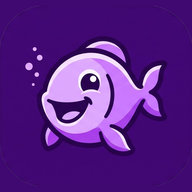

<p align="center">
  
</p>

# Aquarium-Logbuch

<p align="center">
  <strong>🇩🇪 Deutsch</strong> &nbsp;|&nbsp; <a href="README.en.md">🇬🇧 English</a>
</p>

Mehrbenutzer-Webanwendung für Aquarien-Wasserwerte. Node.js (ab Version 22), Express sowie wahlweise **SQLite** (lokal/leichtgewichtig) oder **MongoDB** (produktiv/skalierbar).
Anmeldung wahlweise lokal mit Passwort oder per OAuth 2.0 / OpenID Connect gegen [Pocket ID](https://pocket-id.org).

## Funktionen

- **Flexibles Dual-Datenbanksystem:**
  - **SQLite (Standard lokal):** Dateibasierte, performante Zero-Setup-Datenbank (`data/aquarium.db`) mit WAL-Modus und `busy_timeout` für nebenläufige Zugriffe.
  - **MongoDB (Produktiv):** Volle Unterstützung für MongoDB-Cluster/Container via `DB_TYPE=mongodb` und `MONGODB_URI`.
- **Multithreading & Multi-Core Clustering:**
  - **Frontend Web-Worker-Multithreading:** Dedizierter Web-Worker (`public/worker.js` / `dist/worker.min.js`) für rechenintensive clientseitige Operationen (CSV-Parsing & Trennzeichenerkennung großer Importdateien, Artenkatalog-Volltextsuche mit Fuzzy-Scoring, Besatzkompatibilitätsprüfung, statistische Zeitreihenberechnung sowie asynchrone Bildskalierung & -kompression via `OffscreenCanvas`), um den UI-Thread vollkommen flüssig (60/120 fps) und ruckelfrei zu halten.
  - **Nicht-blockierende Kryptografie (Backend):** Passwort-Hashing und Verifizierung (Scrypt) werden asynchron über den Threadpool abgewickelt, sodass gleichzeitige Anmeldungen den Event-Loop nicht blockieren.
  - **Backend Worker-Thread-Pool:** Dedizierter Worker-Pool für rechenintensive Hintergrund- und Inspektionsaufgaben.
  - **Multi-Worker Clusterbetrieb:** Über `WORKERS=auto` (oder feste Anzahl) verteilt der Supervisor eingehende Anfragen auf mehrere Worker-Prozesse über alle CPU-Kerne hinweg.
  - **Zustandsloses OIDC:** OIDC-Zustände werden kryptografisch signiert und funktionieren prozess- und instanzübergreifend.
- Anmeldung über Pocket ID (OIDC) oder lokal mit Registrierung
- **4 Registrierungs- & Einladungsmodi:**
  - **🟢 Offen:** Jeder Besucher kann sich direkt selbst registrieren.
  - **🔒 Einladung (Admin):** Nur Administratoren können neue Einladungscodes generieren oder Einladungs-E-Mails versenden.
  - **👥 Einladung (Offen):** Alle registrierten Benutzer können im Profil Freunde per Code oder E-Mail einladen.
  - **⛔ Geschlossen:** Registrierung und neue Einladungen sind vollständig deaktiviert.
  - **Flexible Einladungscodes & E-Mails:** Einladungscodes mit konfigurierbarer Gültigkeit (standardmäßig max. 7 Tage für Nutzer, vom Admin konfigurierbar) und Verwendungsbeschränkungen sowie E-Mail-Einladungen (max. 14 Tage Gültigkeit).
- **Light & Dark Mode:** Vollständige Unterstützung für ein helles und augenschonendes dunkles Farbschema:
  - **Systemstandard:** Verwendet standardmäßig die Farbschema-Einstellungen des Betriebssystems (`prefers-color-scheme`).
  - **Umschaltbar:** Schnell-Umschalter in der Kopfzeile und auf der Anmeldeseite sowie feste Auswahlmöglichkeit im Benutzerprofil.
  - **Chart-Anpassung:** Verlaufsdiagramme und Tooltips passen ihre Farbpalette dynamisch an das aktive Farbschema an.
- **🌐 App-weiter modularer i18n & Mehrsprachigkeits-Support (Deutsch & Englisch):**
  - **Standardisiertes JSON-Format:** Vollständig modulare Sprachdateien unter `public/locales/de.json` und `public/locales/en.json` mit strukturierter Verschachtelung und Token-Interpolation (`{count}`, `{name}`, `{days}` etc.).
  - **Umschaltbar & Persistiert:** Direkter 1-Klick-Schnellumschalter (`🌐 DE` / `🌐 EN`) in der Kopfzeile und im Anmeldebereich sowie dauerhafte Sprachauswahl im Benutzerprofil (`#/profile`).
  - **Nahtlose Lokalisierung:** Vollständige Lokalisierung aller Ansichten (Login/Registrierung, Beckenübersicht, Detailansicht, Messmaske, Logbuch, CSV-Import/Export, Artenkatalog, KI-Chat, Admin-Bereich und Rechtsseiten) inklusive sprachspezifischer Datums- und Zahlenformatierung (`Intl.DateTimeFormat` / `Intl.NumberFormat`).
  - **Vollständig im Dist-Bundle integriert:** Automatische Bündelung und Minifizierung im esbuild-Dist-Prozess für minimale Ladezeiten und sofortige Verfügbarkeit ohne zusätzliche Netzwerk-Roundtrips.
- **E-Mail-Verifizierung & Passwort-Reset via SMTP:**
  - **E-Mail-Verifizierung für neue Benutzer:** Neue Registrierungen (außer der Admin-E-Mail-Adresse) erhalten automatisch eine Bestätigungs-E-Mail mit Aktivierungslink. Nicht verifizierte Benutzer werden beim Login geschützt und können sich neue Bestätigungslinks anfordern.
  - **Passwort vergessen & Reset per E-Mail:** Über die Anmeldeseite kann ein zeitlich begrenzter Link zum sicheren Zurücksetzen des Passworts angefordert werden. Beim Zurücksetzen werden alle bestehenden Benutzersitzungen automatisch invalidiert.
  - **Modulare HTML-E-Mail-Templates (.tpl-Dateien):** Jede E-Mail besitzt eine eigene, frei anpassbare `.tpl`-Datei mit HTML-Code und dynamischen Tokens (z. B. `{{username}}`, `{{verifyUrl}}`, `{{resetUrl}}`, `{{expiresHours}}` etc.) unter `src/templates/mail/` (bzw. für eigene Vorlagen unter `data/mail-templates/`).
  - **Rate-Limited Mail-Warteschlange (Queue):** E-Mails werden über eine FIFO-Warteschlange mit konfigurierbarer Verzögerung versendet, um SMTP-Server nicht zu überlasten und Spam-Filter-Trigger zu vermeiden.
  - **SMTP-Konfiguration im Admin-Bereich:** Konfigurierbar über die Admin-Oberfläche (`#/admin`) oder via Umgebungsvariablen (`SMTP_HOST`, `SMTP_PORT`, `SMTP_SECURE`, `SMTP_USER`, `SMTP_PASS`, `SMTP_FROM`) inklusive Versand von Test-E-Mails und Einsicht in den Warteschlangen-Status.
- Benutzerprofil zur Pflege von Profilbild (Avatar), Vorname, Nachname, Benutzername und „Über mich“-Bio sowie Passwortverwaltung, Erscheinungsbild und OIDC-Verknüpfung
- Admin-Bereich mit Benutzerverwaltung für Administratoren (festgelegt anhand der E-Mail-Adresse in der Konfiguration) sowie integriertem System-Logbuch & Fehlerprotokoll
- **Überwachungsprozess & Ausfallsicherheit (Supervisor):** Ein übergeordneter Watchdog-Prozess überwacht die Anwendung, fängt ungeplante Abstürze oder Ausnahmen automatisch ab und startet den Worker-Prozess verzögerungsfrei neu
- **Strukturiertes Fehler- und Ereignis-Logging:** Alle Serverfehler, Uncaught Exceptions, Stderr-Meldungen und Supervisor-Ereignisse werden mit Zeitstempel und Log-Level in eine `.log`-Datei (`data/aquarium.log`) protokolliert
- **Aquarien-Verwaltung mit Motto, Beschreibung & Pflegezyklen:**
  - Aquarien flexibel anlegen und pflegen mit Name, individuellem Motto / Leitspruch, ausführlicher Beschreibung (Scape, Bepflanzung, Philosophie, Technik), Süß- oder Meerwasser, Volumen und Notizen.
  - **Unabhängige Mess- und Düngzyklen:**
    - **🧪 Messzyklus:** Intervall flexibel in Tagen oder Wochen (z. B. alle 3 Tage, wöchentlich, alle 2 Wochen) mit optionalem festen Wochentag (z. B. samstags).
    - **🌿 Düngzyklus:** Unabhängig konfigurierbarer Zyklus in Tagen oder Wochen mit Wochentagsfestlegung für Pflanzendünger.
    - **📧 Optionale Erinnerungs-E-Mails:** Automatische Benachrichtigung per E-Mail (`measure-reminder.tpl` / `fertilize-reminder.tpl`) mit direktem Aktionslink, sobald eine Messung oder Düngung fällig oder überfällig wird.
    - **Status-Tracking:** Übersichtliche Statusanzeigen im Aquarium („Fällig heute“, „Überfällig seit X Tagen“) und Fälligkeits-Badges in der Beckenübersicht.
- **Mehrere Bilder pro Aquarium & Fotogalerie:** Beliebig viele Bilder pro Becken hochladen (PNG, JPG, WebP, GIF bis 5 MB), Bildunterschriften vergeben, Titelbild auswählen und alle Fotos in einer interaktiven Galerie mit Lightbox-Großansicht betrachten
- **Bewohner benennen & Einzelfotos hochladen:** Aquarienbewohner mit individuellen Namen / Bezeichnungen (z. B. Kampffisch „Bubbles“, Pärchen, Gruppen) versehen und eigene Porträtfotos für jeden Bewohner hochladen und ansehen
- **Aquarium-Logbuch & Aktivitäten-Timeline:** Lückenloses, chronologisches Protokoll über alle Arbeiten und Ereignisse am Aquarium:
  - **Wasserwechsel:** Erfassung mit prozentualer Angabe (z. B. 30 %, 50 %) und Details zur Wasseraufbereitung.
  - **Filterpflege:** Filterwechsel (mit Angabe der getauschten Medien wie Filtervlies, Aktivkohle, Schwämme) und Filterreinigung.
  - **Pflanzen & Gärtnern:** Dokumentation von Pflanzenschnitten/Rückschnitt sowie neu eingesetzten Pflanzenarten.
  - **Pflege & Düngung:** Erfassung von Scheibenreinigung, Bodengrundpflege, Düngedosierungen und Spezialfütterungen.
  - **Kombinierte Timeline:** Anzeige aller Pflegemaßnahmen und Wassermessungen in einer gefilterten Übersicht (Alle, Wasserwechsel, Pflege & Filter, Pflanzen, Messungen).
- **Aquarien-Übersicht mit 2 Tabs & Einladungs-Workflow:**
  - **🐠 Eigene Aquarien:** Zeigt übersichtlich alle selbst erstellten Aquarien inklusive Wasserwerten, Alarmanzeigen und Fotos.
  - **👥 Mit mir geteilte Aquarien:** Listet alle Becken auf, die von anderen Aquarianern freigegeben und angenommen wurden.
  - **✉️ Einladungs-Mail & Annahme-Pflicht:** Beim Teilen eines Aquariums wird eine ansprechende Einladungs-E-Mail (`share-aquarium.tpl`) mit Bestätigungslink an den Benutzer versendet. Erst nach Annahme der Einladung (über den E-Mail-Link oder direkt im Tab „Mit mir geteilte Aquarien“) wird das Aquarium für den Benutzer sichtbar und zugänglich.
- Aquarien mit anderen registrierten Benutzern teilen mit flexiblen Berechtigungen:
  - **Lesen (view):** Wasserwerte, Verlaufsgraphen, Besatz, Logbuch und Alarme einsehen.
  - **Schreiben (write):** Messwerte und Pflegeaktivitäten erfassen/bearbeiten/löschen, Besatz verwalten, Alarme bestätigen und Bilder bearbeiten.
- Besatz pro Becken eintragen. Die Fischarten bestimmen die optimalen Grenzwerte
  (Weichwasser, Hartwasser, Garnelen und Wirbellose).
- **Artenkatalog & Besatzprüfung:** Umfassende Datenbank aller gängigen Aquarienbewohner in Deutschland (Salmler, Lebendgebärende, Labyrinthfische/Kampffische, Buntbarsche, Welse, Bärblinge, Garnelen, Schnecken, Meerwasser) mit Wasserwerten, Mindestbeckenvolumen, Sozialverhalten und Territorialregeln.
- **Verhaltens- & Territorialitäts-Prüfung:** Automatische Erkennung von Vergesellschaftungs- und Verhaltenskonflikten (z. B. Einzelhaltung bei Siamesischen Kampffischen, Flossenbeißer vs. Langflosser, Räuber vs. Zwerggarnelen, Krebse vs. Bodenfische, Mindestgruppengrößen bei Schwarmfischen und Temperatur-/pH-Inkompatibilitäten).
- **🤖 Persönlicher KI-Chat-Assistent für Aquarien (Multi-Provider: OpenAI, Google Gemini, Anthropic Claude):**
  - **Umfassender automatischer Beckenkontext:** Bei jeder Chat-Anfrage wird ein präziser System-Prompt injiziert mit Beckenabmessungen, Volumen, Beckentyp, Filtertechnik, Bodengrund, vollständigem Tier- und Pflanzenbesatz (samt Verhaltens- und Artanforderungen) sowie den letzten 10 Wassertests (inklusive Messdatum, Grenzwert-Einstufungen `ok`/`warn`/`crit` und Trendanalyse).
  - **Persistenter Chat-Verlauf & Intelligente Kontext-Komprimierung:** Sämtliche Gespräche werden pro Aquarium dauerhaft in der Datenbank (SQLite & MongoDB) gespeichert und beim Öffnen wiederhergestellt. Ältere Gesprächsrunden werden für den KI-Kontext automatisch intelligent komprimiert und zusammengefasst, sodass die KI über frühere Diagnosen und Ratschläge genau Bescheid weiß, ohne das Token-Budget zu überlasten.
  - **Multi-Provider & Bring Your Own Key (BYOK):** Volle Unterstützung für **OpenAI (ChatGPT)**, **Google Gemini** und **Anthropic Claude**. Jeder Benutzer kann im eigenen Profil persönliche API-Schlüssel hinterlegen, den bevorzugten Provider wählen und verfügbare Modelle dynamisch beim Anbieter abfragen lassen (inklusive Freitext-Eingabe für individuelle Modelle).
  - **Dynamische Modellabfrage:** Beim Eingeben eines API-Keys werden die für den Account freigeschalteten Modelle (z. B. GPT-6, GPT-6-mini, GPT-4o, Gemini 2.5 Flash/Pro, Claude 3.7 Sonnet, Claude 3.5 Haiku) in Echtzeit über die Provider-API abgefragt und im Dropdown zur Auswahl bereitgestellt.
  - **Schwebender Aktionsbutton (FAB):** Direkter Zugriff auf den Chat über einen dezenten Floating Action Button in der Detailansicht des Aquariums – wird dynamisch nur angezeigt, wenn für das Benutzerkonto ein gültiger KI-Schlüssel hinterlegt ist.
  - **Live-Verbindungstest & Schnellstart-Fragen:** Integrierte Schlüssel-Validierung direkt im Profil sowie thematische Schnellfragen im Chat (*„Bewerte meine Wasserwerte“*, *„Passen neue Fische dazu?“*, *„Tipps gegen Algen“*).
  - **Datensparsamkeit & Sicherheit:** Keine Datenweitergabe an KI-Dienste ohne aktive Chatauslösung; API-Schlüssel werden sicher in der Datenbank gespeichert, im UI maskiert und können jederzeit vom Benutzer gelöscht werden.
- Messmaske für 15 Parameter mit Timer pro Test (mehrere gleichzeitig, Ton und Vibration bei Ablauf,
  Bildschirm bleibt während der Timer an, wenn der Browser das erlaubt)
- **PWA & Mobile App Icons (Home-Bildschirm Shortcut):**
  - **Optimiert für Mobilgeräte (iOS & Android):** Vollständige Unterstützung für Homescreen-Shortcuts und Web-App-Installation mit gestochen scharfem App-Icon (lila Fisch mit Blasen auf tiefviolettem Hintergrund).
  - **iOS Apple Touch Icon:** 180×180 px Vollflächen-Icon ohne transparente Ecken für nahtloses, kantenfreies Rendern der Apple-typischen Squircle-Maske.
  - **Android Adaptive & Maskable Icons:** Bereitstellung von 192×192 px und 512×512 px Icons im Standard- (`any`) sowie im adaptiven Maskable-Format (`maskable`), bei dem das Motiv sicher innerhalb der 80%-Safe-Zone liegt und von Android-Launchern (z. B. Kreis, Tropfen, Squircle) ohne abgeschnittene Ränder maskiert wird.
  - **Multi-Resolution Favicons:** Favicons in 16×16, 32×32 sowie Standard `favicon.ico` für Browser-Tabs und Lesezeichen.
- **Push-Benachrichtigungen für Timer:** Automatische System- und Push-Benachrichtigungen bei Ablauf der Reaktionszeiten:
  - **Hintergrund-Timer:** Service Worker stellt sicher, dass Alarme auch dann pünktlich ankommen, wenn der Tab minimiert ist oder im Hintergrund liegt.
  - **Präzises Timing:** Verhindert das Überziehen von Reaktionszeiten und schützt vor Fehlinterpretationen bei Farbvergleichstests.
  - **Status & Testen:** Aktivierungsbanner in der Messmaske sowie Konfigurationskarte und 3-Sekunden-Test-Benachrichtigung im Benutzerprofil.
- **CSV & Excel Export & Import mit Spaltenzuordnung:**
  - **📤 Exportieren (CSV / Excel):** Messwerte für beliebige Zeiträume (oder den gesamten Verlauf) als CSV mit UTF-8-BOM und Semikolon (für Microsoft Excel) oder Komma (Standard-CSV) herunterladen.
  - **📥 Importieren mit interaktiver Spaltenmaske (CSV):** CSV-Dateien per Drag & Drop oder Dateiauswahl hochladen. Die Kopfzeile und Beispielwerte werden automatisch eingelesen.
  - **Intelligente Spaltenzuordnung:** Erkennt automatisch Datum, Uhrzeit, Notiz sowie Wasserparameter (pH, KH, GH, NO2, NO3, PO4, Fe, K, Mg, Ca, Temperatur, Salinität etc.) und ordnet diese vor.
  - **Flexible Datenkonvertierung:** Unterstützt deutsche Datumsformate (`TT.MM.JJJJ`), ISO-Standards, separate Datums-/Uhrzeitspalten und Zahlen mit Komma oder Punkt als Dezimaltrenner.
  - **Integrierte Grenzwertprüfung:** Bei importierten Werten werden Alarme und Warnungen automatisch anhand der Becken-Grenzwerte generiert.
- Live-Bewertung beim Tippen, Eingabe mit Komma möglich
- **Flexible Verlaufsgraphen mit Zeitraumauswahl:**
  - **Standard-Zeitraum 3 Monate (90 Tage):** Beim Öffnen eines Aquariums wird standardmäßig der Verlauf der letzten 3 Monate dargestellt.
  - **Schnellfilter:** Umschaltbar zwischen 7 Tage, 14 Tage, 30 Tage, 3 Monate (Standard), 6 Monate, 1 Jahr und Alles.
  - **Benutzerdefinierter Zeitraum:** Freie Auswahl von Start- und Enddatum per Datumswähler.
  - **Persönliche Voreinstellung:** Im Benutzerprofil kann der gewünschte Standard-Zeitraum für das eigene Konto dauerhaft festgelegt werden.
- **Rechtliche Konformität & Footer (EU AI Act, DDG, DSGVO, Lizenzen & Kontakt):**
  - **Footer auf allen Seiten:** Fester, responsiver Footer mit Schnelllinks zu Impressum, Datenschutz, Lizenzen und Kontakt – erreichbar im angemeldeten und nicht angemeldeten Zustand.
  - **🤖 EU AI Act Transparenz (Art. 50 Verordnung (EU) 2024/1689):** Vollständige Offenlegung der KI-gestützten Softwareerstellung (JetBrains Junie) inklusive Hinweisen zu den Grenzen automatisierter Richtwert- und Berechnungsfunktionen sowie des KI-Aquarium-Assistenten.
  - **⚖️ Impressum (§ 5 DDG & § 18 MStV):** Gesetzeskonforme Anbieterkennzeichnung mit Betreiberangaben, Kontakt-E-Mail und Hinweisen zur EU-Online-Streitbeilegung.
  - **🔒 Datenschutzerklärung (DSGVO / GDPR):** Transparente Erläuterung aller Datenverarbeitungsprozesse (Konto, Aquariendaten, Session-Cookies, SMTP-Mails, Server-Logs, optionale KI-Chat-Dienste via OpenAI, Google Gemini und Anthropic Claude), datensparsames lokales Hosting ohne Drittanbieter-Tracker und Dokumentation der Betroffenenrechte (inkl. CSV-Datenexport und 2-Stufen-Kontolöschung).
  - **📜 Modul-Copyright & Open-Source-Lizenzen:** Lückenlose Auflistung aller verwendeten Open-Source-Module (`express`, `better-sqlite3`, `mongodb`, `chart.js`, Node.js Built-ins) mit Autoren, Versionen und vollständigen Lizenztexten (MIT, Apache 2.0, CC BY-NC-SA 4.0).
  - **✉️ Kontakt & Support:** Direkte Kontaktmöglichkeiten für technischen Support, Administrator-Anfragen und Datenschutzanliegen.
- Warnungen (auffällig) und Alarme (kritisch) mit Handlungshinweis, zum Abhaken
- Erinnerung, wenn die letzte Messung länger her ist als eingestellt

## Starten

### 1. Lokale Entwicklung (SQLite)

```bash
npm ci               # Abhängigkeiten installieren (Node >= 22)
npm run build        # Bündelt das Frontend unminifiziert für Entwicklung (public/dist/app.js)
npm run dist         # Bündelt und minifiziert für Produktion (public/dist/app.min.js)
npm test             # führt alle automatisierten Tests aus (SQLite & MongoDB)
npm start            # startet die App (Standard: SQLite unter http://localhost:3000)
```

- **Frontend-Builds (`npm run build` vs. `npm run dist`):**
  - **`npm run build` (Unminified Entwicklungs-Bundle):** Kompiliert und bündelt sämtliche Frontend-Module schnell nach `public/dist/app.js` und `public/dist/style.css` (inkl. Source-Maps) ohne Minification, ideal für schnelles Debugging und Entwicklung.
  - **`npm run dist` (Minified Produktions-Bundle):** Kompiliert, bündelt und minifiziert das gesamte Frontend hochoptimiert nach `public/dist/app.min.js` und `public/dist/style.min.css` (inkl. Source-Maps) für minimale Übertragungsgrößen im Produktivbetrieb.
  - **Automatischer Server-Fallback:** Der Server (`src/app.js`) erkennt vorhandene Bundles automatisch (bevorzugt `dist/app.min.js`, danach `dist/app.js`, und fällt bei ungebautem Entwicklungsstand transparent auf die ungebündelten ES-Module `app.js` / `style.css` zurück).
  - **Watch-Modi:** Mit `npm run build:watch` (unminified) oder `npm run dist:watch` (minified) werden Änderungen an Quelldateien automatisch in Echtzeit neu gebaut.

### 2. Betrieb mit MongoDB (Docker Compose)

Eine Vorlage für alle Umgebungsvariablen befindet sich in `example.env`.

```bash
# Umgebungsvariablen kopieren und anpassen
cp example.env .env

# App samt MongoDB-Container starten
docker compose up -d --build
```

### 3. Konfigurationsvariablen

| Variable | Standard | Bedeutung |
|---|---|---|
| `DB_TYPE` | `sqlite` (oder `mongodb` falls `MONGODB_URI` gesetzt ist) | Datenbank-Typ (`sqlite` oder `mongodb`) |
| `MONGODB_URI` | `mongodb://localhost:27017/aquarium` | Verbindungszeichenfolge für MongoDB |
| `MONGODB_DB_NAME` | `aquarium` | Optionaler Name der MongoDB-Datenbank |
| `PORT` | 3000 | Port |
| `DATA_DIR` | `./data` | Ordner für Uploads, SQLite-Datenbank & Logdateien |
| `APP_URL` | (leer) | Öffentliche Adresse der App, z. B. `https://aquarium.example.com` oder `https://example.com/aquarium`. Pflicht für OIDC |
| `ALLOW_REGISTRATION` | true | `false` sperrt neue Konten (lokal und beim ersten OIDC-Login) |
| `COOKIE_SECURE` | automatisch | `true`, wenn die App hinter HTTPS läuft. Standard: `true`, wenn `APP_URL` mit `https://` beginnt |
| `TRUST_PROXY` | (aus) | `1`, wenn genau ein Reverse Proxy davorsteht |
| `OIDC_ISSUER` | (leer) | URL des Pocket-ID-Servers, z. B. `https://id.example.com`. Gesetzt = OIDC aktiv |
| `OIDC_CLIENT_ID` | (leer) | Client-ID aus Pocket ID |
| `OIDC_CLIENT_SECRET` | (leer) | Client-Secret aus Pocket ID (leer lassen bei einem öffentlichen Client) |
| `OIDC_SCOPES` | `openid profile email` | Angeforderte Scopes |
| `OIDC_PROVIDER_NAME` | `Pocket ID` | Beschriftung des Anmelde-Buttons |
| `LOCAL_LOGIN` | automatisch | Lokale Anmeldung mit Passwort. Standard: aus, wenn OIDC aktiv ist, sonst an |
| `OIDC_LINK_BY_USERNAME` | false | `true` verknüpft beim ersten OIDC-Login ein vorhandenes lokales Konto mit gleichem Benutzernamen |
| `ADMIN_EMAIL` | (leer) | E-Mail-Adresse des Administrators (oder mehrere durch Komma getrennt) für den Admin-Bereich / Benutzerverwaltung |
| `CONTACT_EMAIL` | `ADMIN_EMAIL` | Optionale Support- & Kontakt-E-Mail-Adresse für Impressum & Kontaktseite |
| `IMPRINT_EMAIL` | `CONTACT_EMAIL` | Optionale E-Mail-Adresse für Anbieterkennzeichnung / Impressum gem. § 5 DDG |
| `SMTP_HOST` | (leer) | SMTP-Server-Host für E-Mail-Versand (auch über Admin-Interface konfigurierbar) |
| `SMTP_PORT` | `587` | SMTP-Port (z. B. `587` für STARTTLS, `465` für SSL/TLS, `25` unverschlüsselt) |
| `SMTP_SECURE` | `false` | `true` für direkte SSL/TLS-Verschlüsselung (Port 465) |
| `SMTP_USER` | (leer) | SMTP-Benutzername |
| `SMTP_PASS` | (leer) | SMTP-Passwort |
| `SMTP_FROM` | `Aquarium-Logbuch <noreply@...>` | Absenderadresse für ausgehende E-Mails |
| `SMTP_RATE_LIMIT_MS` | `500` | Verzögerung zwischen E-Mails in der Queue (Millisekunden) |
| `DEFAULT_AI_PROVIDER` | `openai` | Standard-KI-Provider für den Chat (`openai`, `gemini`, `claude`) |
| `OPENAI_API_KEY` | (leer) | Globaler Fallback-API-Key für OpenAI / ChatGPT (optional) |
| `OPENAI_MODEL` | `gpt-4o-mini` | Standard-Modell für OpenAI Chat Completions |
| `OPENAI_BASE_URL` | `https://api.openai.com/v1` | Optionale Basis-URL für OpenAI API / Proxys |
| `GEMINI_API_KEY` | (leer) | Globaler Fallback-API-Key für Google Gemini (optional) |
| `GEMINI_MODEL` | `gemini-2.5-flash` | Standard-Modell für Google Gemini |
| `CLAUDE_API_KEY` | (leer) | Globaler Fallback-API-Key für Anthropic Claude (optional) |
| `CLAUDE_MODEL` | `claude-3-5-haiku-20241022` | Standard-Modell für Anthropic Claude Messages API |
| `LOG_FILE` | `./data/aquarium.log` | Pfad zur `.log`-Datei für Fehler- und Systemprotokolle |
| `SUPERVISOR` | `true` | `false` startet die Anwendung im Einzelprozess ohne Überwachungs-Watchdog |
| `WORKERS` | `1` (bzw. `auto` in Docker) | Anzahl der Worker-Prozesse (`auto` = alle CPU-Kerne) |
| `WORKER_THREADS` | `auto` | Anzahl der Worker-Threads für rechenintensive Aufgaben (Scrypt, Datenanalyse) |

## Benutzerprofil und Kontoverwaltung

Jeder angemeldete Benutzer kann über die Kopfzeile auf sein **Benutzerprofil** (`#/profile`) zugreifen:
- **Profilbild (Avatar):** Hochladen (JPG, PNG, WebP, GIF bis 5 MB) oder Löschen des eigenen Profilbilds.
- **Persönliche Angaben:** Pflege von Vorname, Nachname, Benutzername, „Über mich“-Bio und E-Mail-Adresse.
- **Standard-Zeitraum für Graphen:** Festlegung des bevorzugten Zeitraums (z. B. 3 Monate, 6 Monate, 1 Jahr) für die Verlaufsgraphen.
- **🤖 KI-Assistent & Sprachmodelle:**
  - Auswahl des bevorzugten Anbieters (**OpenAI / ChatGPT**, **Google Gemini**, **Anthropic Claude**).
  - Sichere Hinterlegung und Maskierung persönlicher API-Keys.
  - Dynamische Modellauswahl direkt vom Anbieter (mit Echtzeit-Abfrage bei Key-Eingabe sowie benutzerdefinierter Freitexteingabe).
  - Integrierter Live-Verbindungstest und vollständiges Löschen gespeicherter Schlüssel mit einem Klick.
- **Passwortverwaltung:** Ändern des aktuellen Passworts (bei lokaler Anmeldung).
- **OIDC-Verknüpfung:** Direktes Verknüpfen oder Entkoppeln des Kontos mit Pocket ID / OpenID Connect.
- **Freunde einladen (bei aktivem Einladungsmodus):** Registrierungscodes (bis maximal 7 Tage bzw. konfigurierte Gültigkeit) und E-Mail-Einladungen (bis maximal 14 Tage Gültigkeit) erstellen, den Status einsehen und Einladungslinks direkt teilen.
- **Konto löschen (Zweistufige Bestätigung):**
  - **1. Schritt (In der Anwendung):** Bestätigung im Profilbereich (bei lokaler Anmeldung inklusive Passworteingabe) zur Auslösung der Löschanforderung.
  - **2. Schritt (Per E-Mail):** Aus Sicherheitsgründen wird eine Bestätigungs-E-Mail mit einem zeitlich begrenzten Bestätigungslink versendet. Erst durch Klick auf diesen Link wird die Löschung endgültig vollzogen.
  - **Kaskadierende Datenbereinigung:** Bei der Bestätigung werden das Benutzerkonto, alle eigenen Aquarien samt Fotos (auf dem Server und in der Datenbank), Bewohner, Besatzbilder, Messwerte, Alarme, Pflegemaßnahmen, Freigaben und aktive Sitzungen restlos und konsistent entfernt. Der Administrator-Account ist vor versehentlicher Profil-Löschung geschützt.

## Admin-Bereich und Benutzerverwaltung

Der Administrator wird anhand der E-Mail-Adresse festgelegt. Dazu entweder in `config.js` oder über die Umgebungsvariable `ADMIN_EMAIL` die gewünschte E-Mail-Adresse hinterlegen (z. B. `ADMIN_EMAIL=admin@example.com` bzw. kommagetrennt für mehrere).

- Benutzer, deren E-Mail-Adresse (aus OIDC/Pocket ID oder lokaler Registrierung) mit `ADMIN_EMAIL` übereinstimmt, erhalten Administrator-Rechte.
- Im Header erscheint der Button **Admin** (`#/admin`).
- Administratoren können alle registrierten Benutzer einsehen, neue Benutzer anlegen, bestehende Benutzer bearbeiten (Benutzername, E-Mail, Passwort ändern) und Benutzer samt deren Daten löschen.
- **Registrierungs-Modi & Einladungs-Verwaltung:**
  - Umschalten zwischen den 4 Modi: **Offen**, **Einladung (Admin)**, **Einladung (Offen)** und **Geschlossen**.
  - Konfiguration der maximalen Gültigkeit für Benutzer-Einladungscodes (Standard: 7 Tage).
  - Erstellung von Admin-Einladungscodes mit individueller Verwendungsanzahl (z. B. unbegrenzt oder einmalig) sowie E-Mail-Einladungen.
  - Übersicht aller aktiven, eingelösten und abgelaufenen Einladungen inklusive Widerruf- / Löschfunktion.
- **E-Mail- & SMTP-Server-Konfiguration:**
  - Konfiguration des SMTP-Ausgangsservers für E-Mail-Verifizierungen, Passwort-Reset und Benachrichtigungen.
  - Warteschlangen-Statusanzeige und Live-Testmail-Versand.
- **Rechtliches & Kontakt-E-Mails (Impressum & Support):**
  - Eigene E-Mail-Adressen für Support-/Datenschutz-Anfragen (`CONTACT_EMAIL`) und das Impressum (`IMPRINT_EMAIL` gem. § 5 DDG) direkt über die Weboberfläche oder per Umgebungsvariablen festlegen.
- **Backup & Restore (Datensicherung & Wiederherstellung):**
  - **Manuelle Backups:** Vollständige Sicherung der gesamten Datenbank (Benutzer, Aquarien, Messwerte, Alarme, Logbuch) inklusive aller hochgeladenen Fotos als komprimierte Datei (`.json.gz`).
  - **Wiederherstellung (Restore):** Einspielen von Sicherungsdateien über die Weboberfläche oder aus der lokalen Backup-Liste.
  - **Abwärtskompatibilität & Migration:** Backups älterer Versionen (z. B. v1 ohne neue Tabellen/Felder oder mit separater Messwerttabelle) werden beim Einspielen automatisch auf das aktuelle Datenbankschema migriert und normalisiert.
  - **Automatische lokale Sicherungen:** Im Admin-Bereich konfigurierbar (Aktivieren/Deaktivieren, Intervall in Stunden z. B. alle 6h, 12h, 24h, Vorhalteanzahl/Retention z. B. max. 10 Backups und automatisches Pruning alter Dateien).
  - **Sicherheit & Zugriffsschutz:** Alle Backup- und Restore-Funktionen sind strikt auf Administratoren beschränkt.
- **System-Logbuch:** Live-Einsicht und Bereinigung der Server- und Fehlerprotokolle (`data/aquarium.log`).

## Anmeldung mit Pocket ID (OIDC)

1. In Pocket ID unter *OIDC Clients* einen neuen Client anlegen:
   - **Callback URL:** `<APP_URL>/auth/callback`, z. B. `https://aquarium.example.com/auth/callback`
   - **Logout Callback URL:** `<APP_URL>/`, z. B. `https://aquarium.example.com/`
   - Optional: Zugriff über *Allowed User Groups* auf bestimmte Gruppen beschränken.
2. Client-ID und Client-Secret übernehmen und die App starten, z. B.:

```bash
APP_URL=https://aquarium.example.com \
OIDC_ISSUER=https://id.example.com \
OIDC_CLIENT_ID=... OIDC_CLIENT_SECRET=... \
TRUST_PROXY=1 npm start
```

Die App nutzt den Authorization Code Flow mit PKCE, prüft die Signatur des ID-Tokens über die JWKS des Servers
sowie `iss`, `aud`, `exp` und `nonce`. Beim ersten Login wird automatisch ein Konto angelegt
(Benutzername aus `preferred_username`), die Zuordnung erfolgt dauerhaft über die `sub` des Benutzers.
"Abmelden" beendet auch die Sitzung bei Pocket ID.

**Umstieg und nachträgliche Zuordnung von lokalen Konten:**
- **Selbstverknüpfung:** Angemeldete Benutzer können ihr Konto in der Kopfzeile über „Mit Pocket ID verknüpfen“ direkt mit Pocket ID verbinden.
- **Automatisch per E-Mail:** Stimmt die im lokalen Konto hinterlegte E-Mail-Adresse mit der E-Mail-Adresse aus Pocket ID überein, wird das Konto beim OIDC-Login automatisch zugeordnet.
- **Admin-Benutzerverwaltung:** Administratoren können in der Benutzerverwaltung die OIDC-Benutzer-ID (`sub`) für jedes Konto direkt eintragen, ändern oder löschen.
- **Per Benutzername:** Mit `OIDC_LINK_BY_USERNAME=true` wird ein vorhandenes Konto beim ersten Pocket-ID-Login übernommen, wenn der Pocket-ID-Benutzername übereinstimmt (nur aktivieren, wenn Benutzer sich in Pocket ID keine beliebigen Namen vergeben können).

**App unter einem Unterpfad:** `APP_URL` darf einen Pfad enthalten (z. B. `https://example.com/aquarium`).
Der Reverse Proxy muss diesen Präfix dann entfernen, bevor er an die App weiterleitet
(Caddy: `handle_path /aquarium/* { reverse_proxy localhost:3000 }`).

## Wassertests und Testsuiten (JSON-konfigurierbar)

Die Wassertests sind modular als **JSON-Dateien** unter `src/config/suites/` (bzw. für eigene Erweiterungen unter `data/suites/`) abgelegt:
- **Standard-Suite (`jbl-pro-aquatest.json`):** JBL PRO AQUATEST Testlab Tropfentests nach offizieller Gebrauchsanweisung mit verifizierten Reaktionszeiten (z. B. Kalium 90 s, Nitrit 5 min, Nitrat 10 min, Ammonium 10 min, Phosphat 10 min, Eisen 10 min, Kupfer 15 min, Silikat 3 min).
- **Konsolidierter pH-Wert:** Statt unübersichtlicher Einzeltests für verschiedene pH-Bereiche existiert ein einheitlicher pH-Test (3,0 bis 10,0), bei dem der Messwert direkt erfasst wird.
- **Weitere Suiten:** Beliebig erweiterbar (z. B. `jbl-easy-7in1.json` für Teststreifen).
- **Benutzerauswahl:** Jeder Anwender kann sowohl im Profil (`#/profile`) als auch direkt bei der Messung (`#/a/:id/messen`) auswählen, welche Testsuite er nutzt und welche Tests er besitzt/durchführen möchte. Die Auswahl wird dauerhaft im Benutzerkonto und im Browser gespeichert.

## Artenkatalog und Besatz-Kompatibilitätsprüfung

Der Besatz wird über modulare **JSON-Artenkataloge** unter `src/config/species/` (bzw. für eigene Erweiterungen unter `data/species/`) gesteuert:
- **Kataloge:**
  - `freshwater-popular.json`: Gängige Salmler, Lebendgebärende, Labyrinthfische, Bärblinge, Welse und Schmerlen.
  - `cichlids.json`: Südamerikanische Zwergbuntbarsche, Skalare, Diskusfische sowie ostafrikanische Buntbarsche (Malawi / Tanganjika).
  - `invertebrates.json`: Zwerggarnelen, Fächergarnelen, Zwergflusskrebse und Zierschnecken.
  - `saltwater.json`: Meerwasserfische, Anemonenfische, Putzergarnelen und Einsiedlerkrebse.
- **Artenkatalog-Ansicht (`#/species`):** Durchsuche und filtere alle Bewohner nach Wassertyp oder Kategorie und sieh dir Wasseranforderungen (Temperatur, pH, GH, KH), Mindestbeckenvolumen, Schwimmzone und Wesen an.
- **Verhaltens- & Territorialitäts-Prüfung:**
  - **Kampffische (*Betta splendens*):** Prüfung auf strikte Einzelhaltung (mehrere Kampffische in einem Becken lösen kritische Alarme aus), Schutz vor Flossenbeißern (Sumatrabarbe, Blutsalmler) und Rivalitätswarnung bei bunten Schleierfischen (Guppys).
  - **Mindestbeckengrößen:** Warnung, wenn das Aquarium kleiner ist als das empfohlene Mindestvolumen einer Art (z. B. Skalare ab 200 L, Diskus ab 300 L, Prachtschmerlen ab 400 L).
  - **Schwarmgrößen:** Warnung bei Schwarmfischen (Neonsalmler, Rotkopfsalmler, Zebrabärblinge), wenn weniger als die empfohlene Mindestanzahl gehalten wird.
  - **Räuber-Beute & Flossenschutz:** Warnungen vor Zwerggarnelen-Verlusten bei größeren Raubfischen (Skalare/Buntbarsche), Zwickgefahren bei Krebsen und Schneckenfressern (Raubschnecke Helena, Prachtschmerle) bei Zierschnecken.
  - **Biotop- und Wasserwertkonflikte:** Automatische Erkennung unvereinbarer Ansprüche (z. B. alkalische Malawi-/Tanganjika-Buntbarsche vs. Weichwasser-Südamerikaner oder Kaltwasserfische wie Kardinalfische vs. wärmebedürftige Tropenfische).

## Wartezeiten und Grenzwerte prüfen

Die Testparameter und Standardwerte liegen in `src/config/suites/jbl-pro-aquatest.json` und `config.js`.

- **Wartezeiten:** Alle Zeiten im Standard-Set basieren auf der JBL Testlab-Gebrauchsanweisung (`verified: true`). Eigene Testsuiten können jederzeit als JSON ergänzt werden.
- **Grenzwerte:** Richtwerte für Süß- und Meerwasser. Prüfe sie für dein Becken und passe sie an.
  Die App ersetzt keine Beratung durch Fachleute.

## Betrieb

- **HTTPS:** Hinter einen Reverse Proxy (Caddy, nginx, Traefik) stellen, `APP_URL=https://...` (oder `COOKIE_SECURE=true`) sowie `TRUST_PROXY=1` setzen.
- **Backup:** `sqlite3 data/aquarium.db ".backup backup.db"` (die Datenbank läuft im WAL-Modus,
  daher nicht einfach nur die .db-Datei kopieren).
- **Passwörter** (nur lokale Anmeldung) werden mit scrypt gehasht, Sitzungen als Hash in der Datenbank gespeichert.

## Bekannte Grenzen

- Automatischer E-Mail-Versand bei Grenzwert-Alarmen ist für ein zukünftiges Release vorgesehen.

## Lizenz & Copyright

Dieses Projekt steht unter der **Creative Commons Attribution-NonCommercial-ShareAlike 4.0 International Lizenz (CC BY-NC-SA 4.0)**.

- **✅ Erlaubt (Privat & Community):**
  - Kostenlose Nutzung, Installation und Betrieb für den privaten und persönlichen Gebrauch.
  - Modifikation, Anpassung und Weiterentwicklung des Quellcodes.
- **🔄 Pflicht (Copyleft & Attribution):**
  - **ShareAlike:** Abgeleitete Werke und Weiterentwicklungen müssen unter derselben Lizenz (CC BY-NC-SA 4.0) veröffentlicht werden.
  - **Attribution:** Urheberhinweise und Verweise auf das Originalprojekt müssen erhalten bleiben.
- **⛔ Untersagt (Nicht-kommerziell):**
  - Jegliche kommerzielle Nutzung, der Weiterverkauf oder das Anbieten der Anwendung als entgeltliche Dienstleistung (z. B. kommerzielles SaaS-Hosting) ohne vorherige schriftliche Genehmigung des Urhebers.
- **📜 Drittanbieter-Lizenzen:**
  - Verwendete Open-Source-Module (`express`, `better-sqlite3`, `chart.js` unter MIT License; `mongodb` unter Apache License 2.0).

Vollständiger Lizenztext: Siehe [LICENSE](LICENSE) sowie in der App unter `#/lizenzen`.

## Geplante Erweiterungen & Roadmap

- [x] KI-Chat-Assistent für Aquarien mit Multi-Provider-Unterstützung (OpenAI, Google Gemini, Anthropic Claude) und automatischem Beckenkontext (Maße, Besatz, Grenzwerte, die letzten 10 Messungen).
- [ ] Automatischer E-Mail-Versand bei kritischen Grenzwert-Alarmen.