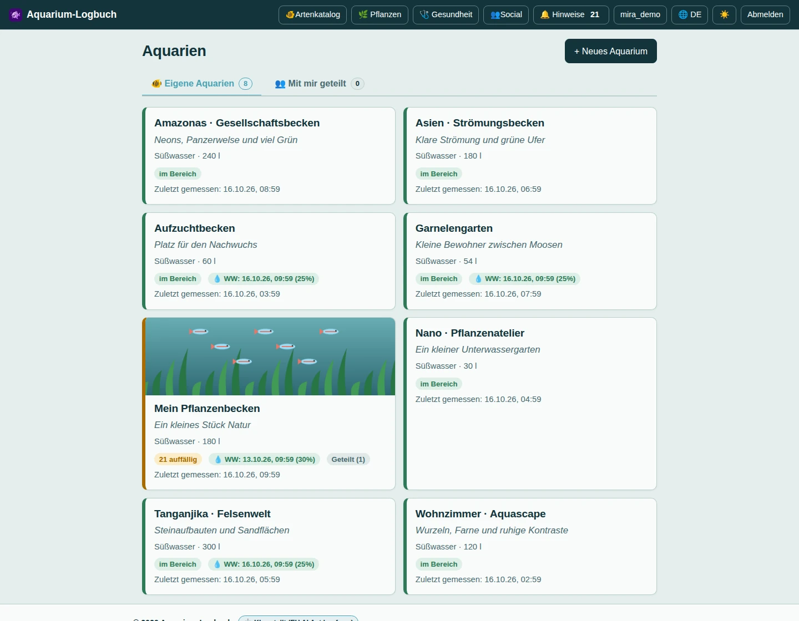
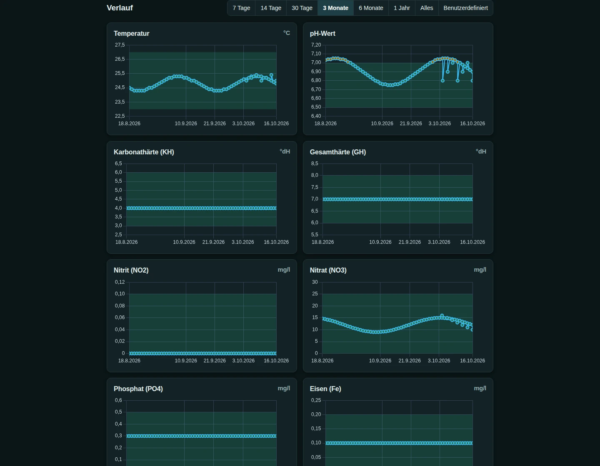
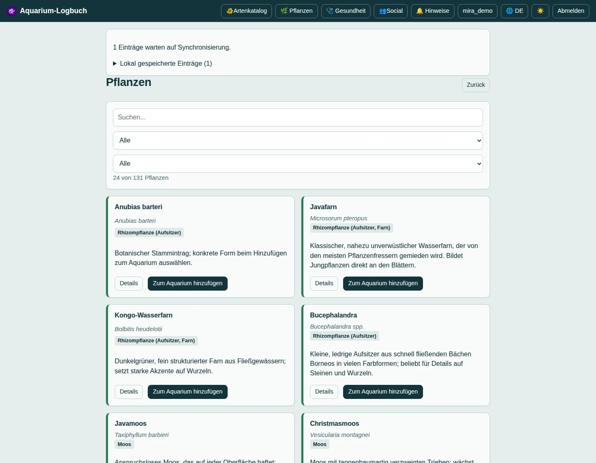
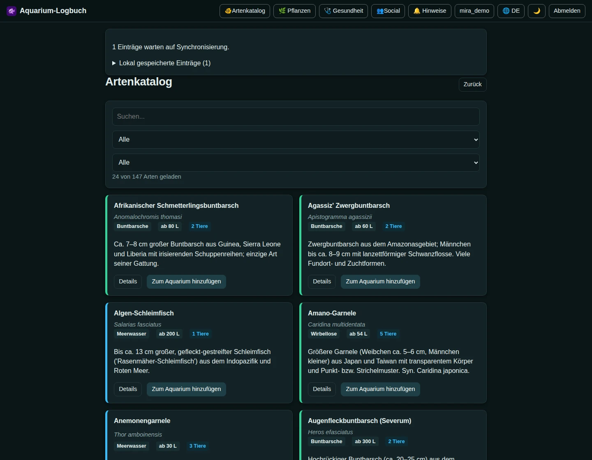

<p align="center">
  
</p>

# Aquarium-Logbuch

Aquarium-Logbuch ist eine selbst gehostete Web-App für Wasserwerte, Besatz und Aquarienpflege. Sie verbindet Messverläufe, Pflegeprotokolle und Erinnerungen und unterstützt mehrere Benutzer mit getrennten oder geteilten Aquarien. Ein Artenkatalog, ein Diagnose-Assistent und ein optionaler KI-Chat ergänzen die Verwaltung von Süß- und Meerwasserbecken.

**Deutsch** · [English](README.en.md) · [📖 Nutzerhandbuch mit Screenshots](https://aquarium-logbuch.de/handbuch) · [Technische Dokumentation](docs/de/README.md) · [Changelog](CHANGELOG.md)

**Neu dabei?** Öffne das öffentliche **[Nutzerhandbuch](https://aquarium-logbuch.de/handbuch)** über den Link im App-Footer oder unter `<App-Adresse>/handbuch/`. Es ist auf Deutsch und [Englisch](https://aquarium-logbuch.de/handbuch/en/) verfügbar, erklärt alle Bereiche mit Schrittfolgen und Demo-Screenshots, funktioniert ohne Anmeldung und lädt seine Bilder erst beim Lesen. [Handbuch pflegen oder separat bereitstellen](docs/user-guide/README.md).

## Transparenzhinweis: KI-generierte Software

**Diese App wurde mithilfe generativer KI geschrieben und weiterentwickelt.** Quellcode und Dokumentation enthalten KI-generierte Inhalte. Dieser Hinweis dient der freiwilligen Transparenz in Anlehnung an [Artikel 50 des EU AI Act (Verordnung (EU) 2024/1689)](https://ai-act-service-desk.ec.europa.eu/en/ai-act/article-50); er ist keine Erklärung vollständiger Rechtskonformität. Aus der KI-gestützten Entwicklung allein folgt keine pauschale Kennzeichnungspflicht für jede Software.

Im optionalen KI-Chat interagierst du mit einem KI-System; dessen Antworten sind automatisch generiert und können fehlerhaft oder unvollständig sein. Prüfe Empfehlungen vor der Anwendung. Wasserwertbewertungen und Verdachtsdiagnosen ersetzen keine fachliche oder tierärztliche Untersuchung. Beim Absenden einer Chat-Anfrage werden Nachrichten und Aquariumkontext an den ausgewählten KI-Anbieter übermittelt; Details stehen im [KI-Handbuch](docs/de/ai-chat.md).

## Einblicke in die App

Echte App-Ansichten mit fiktiven Demo-Daten: zwei im hellen und zwei im dunklen Design. Klicke auf ein Bild, um es in voller Größe zu öffnen.

| Aquarienübersicht · hell | Aquariumdetails mit Messverläufen · dunkel |
| --- | --- |
| [](docs/screenshots/aquarien-light.webp) | [](docs/screenshots/messwerte-dark.webp) |
| **Pflanzenübersicht · hell** | **Fische und Artenkatalog · dunkel** |
| [](docs/screenshots/pflanzen-light.webp) | [](docs/screenshots/fische-dark.webp) |

Weitere Ansichten und Schrittfolgen findest du im [öffentlichen Nutzerhandbuch](https://aquarium-logbuch.de/handbuch).

## Features für Benutzer

- **Aquarien verwalten:** Stammdaten, Einrichtung, Fotos, Galerie und benannte Bewohner mit Porträts.
- **Wasserwerte erfassen:** 18 Parameter, frei kombinierbare Tests aus den Suiten von JBL, Amtra, sera und Tetra, Live-Bewertung und mehrere Reaktionstimer. Timer-Hinweise mit „Timer beenden“ und „Test öffnen“; beim Testwechsel andere Entwürfe erhalten. Tests je Aquarium pausieren, dauerhaft lokal sichern und über den aufklappbaren „Offene Tests“-Button auch auf anderen Geräten fortsetzen. Geräteabgleich mit Offline-Warteschlange: ergänzte und gleiche Messwerte automatisch zusammenführen, nur widersprüchliche Angaben einzeln auswählen.
- **Verlauf auswerten:** Diagramme mit freier Zeitraumauswahl, Warnungen und bestätigbare Alarme.
- **Pflege dokumentieren:** Logbuch für Wasserwechsel, Filterpflege, Pflanzen, Düngung und weitere Aktivitäten.
- **Pflege planen:** Messzyklen mit optionalen E-Mail-Erinnerungen; Düngerbereich mit individuellen Erinnerungen für manuelle Dünger und automatischer Protokollierung geplanter Pumpendosierungen.
- **Wassertest-Verbrauch verfolgen:** Automatische Zählung, korrigierbare Füllmengen und Nachkauferinnerung ab 75 % Verbrauch.
- **Besatz prüfen:** Artenkatalog mit Haltungsanforderungen, Bildern und Hinweisen zu Gruppen, Beckengröße und Verträglichkeit.
- **Formen auswählen:** Zuchtformen, botanische Varietäten und Handelsnamen finden, ohne zusätzliche Kacheln; die konkrete Form erst beim Hinzufügen von Tieren oder Pflanzen auswählen.
- **Pflanzen verwalten:** Zweisprachiger Pflanzenkatalog mit Pflegeanforderungen und Bildern sowie Pflanzenbestand mit Stückzahlen je Aquarium.
- **Gesundheit einschätzen:** Krankheitskatalog, Diagnose-Assistent und Medikamente/Hilfsmittel mit Quellen, Rechtsstatus und Warnhinweisen.
- **KI-Assistent nutzen:** Optionaler Aquarium-Chat mit OpenAI, Google Gemini oder Anthropic Claude und verschlüsselt gespeichertem persönlichem API-Schlüssel.
- **Daten mitnehmen und teilen:** CSV-Import mit Spaltenzuordnung, Excel-kompatibler CSV-Export und Aquariumfreigaben mit Lese- oder Schreibzugriff.
- **Konto anpassen:** Profil, Avatar, Passwortverwaltung, lokale Anmeldung oder Pocket ID/OIDC und Einladungen.
- **Mobil verwenden:** Deutsch/Englisch, helles/dunkles/systemabhängiges Design, Homescreen-Installation und Timer-Benachrichtigungen.
- **Offline arbeiten:** Bereits synchronisierte Aquarien, Messwerte, Pflegeprotokolle, Besatz, Pflanzen und Bilder lokal nutzen; Änderungen dauerhaft vormerken und bei Verbindung synchronisieren. Konflikte zwischen Geräten werden zur Entscheidung angezeigt.
- **Kataloge offline nutzen:** Heruntergeladene Arten-, Pflanzen- und Gesundheitskataloge durchsuchen und Details anzeigen. Diagnoseberechnung, Verträglichkeitsprüfung und CSV-Verarbeitung laufen lokal; der KI-Chat benötigt weiterhin eine Verbindung.
- **Aktuell bleiben:** Update-Angebot nur bei geänderten Frontend-Inhalten; Aktivierung und Neuladen nach Bestätigung. Reine Backend- oder Katalogdatenänderungen lösen keinen Frontend-Update-Hinweis aus.
- **Social-Community:** Bilderfeed mit wählbarer öffentlicher oder serverinterner Sichtbarkeit, Texten, Profilbildern, Likes, Kommentaren und Teilen-Links; Uploads werden serverseitig auf 1600 Pixel begrenzt. [Details](docs/de/social.md).
- **Benachrichtigungen bündeln:** Zentraler Bereich mit Zähler für Likes und Kommentare zu eigenen Beiträgen sowie offene Wasserwertwarnungen aus allen zugänglichen Aquarien.

## Technische Features

- Vue 3, Vite und TypeScript im Frontend; Express und TypeScript im Backend.
- Node.js ab **22.12** oder Bun ab **1.4.3**; SQLite oder MongoDB.
- Web Worker für rechenintensive Frontend-Aufgaben, Backend-Threadpool und optional mehrere Serverprozesse mit Supervisor.
- Abschnittsweises Nachladen von Aquariumdetails und abbrechbare Datenanfragen.
- Gemeinsame Arten- und Pflanzenkataloge; JSON-Daten für Krankheiten, Medikamente und Testsuiten; deutsche und englische Sprachdateien.
- SMTP-Warteschlange mit anpassbaren E-Mail-Vorlagen und Testversand.
- Datenbankgestützte Administratorrollen für mehrere Benutzer; Admin-Bereich für Benutzer, Registrierungsmodi, Einstellungen, anonyme Nutzungsmetriken, Backups und Logs.
- Zweisprachiger Ersteinrichtungs-Wizard für das erste Admin-Konto, SMTP, automatische Backups und den Registrierungsmodus; die übrige Anwendung bleibt bis zum Abschluss gesperrt.
- Datenbankmigrationen, verschlüsselte manuelle/automatische Sicherungen und passwortgeschützte Wiederherstellung inklusive Uploads.
- Docker-Images für AMD64/ARM64; Compose-Vorlagen für SQLite und MongoDB.
- GitHub baut und veröffentlicht Docker-Images nur bei Änderungen an App, Server oder ausgelieferten Ressourcen; reine README- und Screenshot-Änderungen lösen keine neue Version aus. [Build- und Versionsregeln](docs/de/versioning.md#builds-nur-bei-relevanten-änderungen).
- Automatische Versionsberechnung aus Commit-Typen, Typprüfung und parallel isolierte Tests für beide Datenbankadapter und Runtimes.

## Offline-Betrieb und getrennte Updates

Die App trennt drei Stände: die allgemeine App-Version, den Inhaltshash der Frontend-Dateien und die eigenen Inhaltsversionen der Arten-, Pflanzen- und Gesundheitskataloge. Das Frontend prüft beim Start, alle fünf Minuten in sichtbaren Tabs sowie bei Rückkehr zum Tab oder wiederhergestellter Verbindung nur eine kleine Versionsdatei. Der Hash wird beim Build erzeugt. Unveränderte Dateien werden aus dem bisherigen Service-Worker-Cache übernommen; andere offene Tabs können ihre bisherige Fassung weiterverwenden. Details stehen unter [Versionen und Updates](docs/de/versioning.md).

Aquariendaten und ausstehende Änderungen liegen benutzergetrennt in IndexedDB. Nach einem ersten erfolgreichen Online-Abgleich sind lokale Erfassung und Bearbeitung auch ohne Verbindung möglich. Der Server prüft bei der Übertragung erneut Sitzung und Berechtigungen; Operations-IDs verhindern doppelte Einträge bei Wiederholungen. Konkurrierende Änderungen werden als Konflikt angezeigt und nicht still überschrieben. Noch nicht übertragene Änderungen liegen ausschließlich auf dem jeweiligen Gerät und sind nicht in Server-Backups enthalten.

Referenzkataloge werden separat geladen und versioniert abgeglichen. Vorhandene Offline-Kataloge werden regulär höchstens alle zwölf Stunden geprüft. Reine Änderungen an Arten, Pflanzen, Krankheiten, Diagnosefragen, Medikamenten und Katalogbildern benötigen kein Frontend-Update. Änderungen an Ansichten oder Browserlogik erzeugen weiterhin eine neue Frontend-Fassung.

Für Service Worker und Offline-Neustarts ist HTTPS erforderlich; `localhost` ist die Ausnahme für lokale Entwicklung. Auf dem Handy reicht eine HTTP-LAN-Adresse nicht aus. Browser und Betriebssystem können lokale Daten löschen; eine Homescreen-Installation ersetzt keine Datensicherung. Authentifizierung, Kontosicherheit, KI, Freigaben, Social und Administration benötigen weiterhin eine Serververbindung.

## Schnellstart

Mit Node.js und SQLite:

```bash
npm ci
npm run dist
npm start
```

Für die Codeprüfung `npm run lint` ausführen; `npm run lint:fix` behebt automatisch korrigierbare Befunde. ESLint prüft TypeScript, Vue-Komponenten, JavaScript-Skripte und Tests.

Die App läuft unter `http://localhost:3000`. Bei einer leeren Installation führt sie zuerst durch den Einrichtungs-Wizard für Administrator, SMTP, Backups und Registrierung. Für Entwicklung mit Hot Reload zusätzlich `npm run dev` in einem zweiten Terminal starten. Bun, Docker, SMTP, OIDC und alle Umgebungsvariablen sind unter [Installation und Konfiguration](docs/de/installation.md) beschrieben. [example.env](docker/example.env) dient als Konfigurationsvorlage; passe insbesondere öffentliche URL und Datenbankzugang an.

Mit Docker Compose und MongoDB:

```bash
docker compose --project-directory . -f docker/docker-compose.yml pull
docker compose --project-directory . -f docker/docker-compose.yml up -d
```

Für SQLite stattdessen `docker compose --project-directory . -f docker/docker-compose.sqlite.yml up -d` verwenden. Vorher die jeweilige Compose-Konfiguration anpassen.

## Dokumentation

- [Handbuch und Modulübersicht](docs/de/README.md): Bedienung, Funktionsweisen und Konfiguration.
- [Entwicklung und Architektur](docs/de/architecture.md): Quellstruktur, Build, Worker und Tests.
- [Versionen und Commit-Standard](docs/de/versioning.md): `feat(bereich): …` erhöht die Revision, `fix(bereich): …` den Patch; andere Typen verändern die Version nicht.
- [Administration und Backups](docs/de/administration.md): Benutzerverwaltung, SMTP, Sicherungen und Wiederherstellung.
- [Codeprüfung und Betriebsgrenzen](docs/AUDIT.md).

## Grenzen und Ausblick

Grenzwerte und Verdachtsdiagnosen sind Orientierungshilfen und ersetzen keine fachliche Untersuchung. Timer-Benachrichtigungen und Hintergrundausführung hängen von Browser und Betriebssystem ab. Der Offline-Betrieb umfasst zuvor synchronisierte Daten und die unterstützten lokalen Aktionen; Funktionen mit Serverbedarf bleiben online. Dosierpumpenpläne steuern keine Hardware. Automatische E-Mails bei kritischen Grenzwert-Alarmen sind geplant.

## Lizenz

[CC BY-NC-SA 4.0](LICENSE): nicht-kommerzielle Nutzung mit Namensnennung; abgeleitete Werke unter derselben Lizenz. Kommerzielle Nutzung benötigt die vorherige schriftliche Genehmigung des Urhebers. Bibliotheken und Artenbilder behalten ihre eigenen Lizenzen und Bildnachweise.
