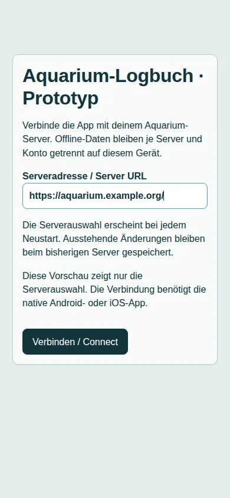

# Capacitor-Prototyp für Android und iOS

[Projektübersicht](../../README.md) · [English](../en/mobile.md)

Der Prototyp nutzt dieselben Vue-Ansichten und dieselbe browserfähige Fachlogik wie die Web-App. Express und die Datenbank laufen weiterhin auf dem gewählten Aquarium-Server. Das ist ein Entwicklungsstand, noch keine freigegebene mobile App.

## Bauen und starten

Abhängigkeiten mit `npm ci` installieren. `npm run build:mobile` prüft die Frontend-Typen und erzeugt `dist/mobile/index.html`, Icons und sämtliche Browser-Chunks unter `dist/mobile/dist`. Der Web-Build unter `public/dist` bleibt davon getrennt. Backendmodule, Katalogdaten, Handbuch und Service Worker werden nicht in das mobile Paket aufgenommen.

```sh
npm run mobile:sync
npm run mobile:android
# Auf einem Mac mit Xcode:
npm run mobile:ios
```

`mobile:sync` baut die Oberfläche und führt `cap sync` für die eingecheckten Projekte `android/` und `ios/` aus. Danach in Android Studio oder Xcode einen Emulator bzw. ein Gerät auswählen. Ein nativer Build benötigt die Entwicklungswerkzeuge der Plattform; `cap sync` erzeugt allein noch keine APK oder IPA. Die Anforderungen richten sich nach dem installierten Capacitor 8: [Android](https://capacitorjs.com/docs/android), [iOS](https://capacitorjs.com/docs/ios).

Der iOS-Build benötigt macOS und Xcode. Für TestFlight oder den App Store zusätzlich Apple-Developer-Mitgliedschaft, Signing und App Store Connect einrichten. Der vorhandene iOS-Unterbau verwendet Swift Package Manager. Die Kennung `de.aquariumlogbuch.prototype` ist eine Entwicklungskennung; vor einer Veröffentlichung eine eigene Kennung sowie native Versions-/Buildnummern und App-Grafiken festlegen. Signierschlüssel und Provisioning-Dateien nicht ins Repository aufnehmen.

## Server auswählen

Beim Start eine HTTPS-Adresse wie `https://aquarium.example.org/` oder `https://example.org/aquarium/` eingeben und „Verbinden“ wählen. Ein gültiges, vom Gerät akzeptiertes TLS-Zertifikat ist erforderlich. Zugangsdaten, Query-Parameter und Fragmente sind in der Serveradresse nicht erlaubt. Die letzte Adresse wird vorgeschlagen; eine Verbindung beginnt erst nach der Auswahl. Die Browser-Vorschau kann die Auswahl anzeigen, lässt die Verbindung aber nur in der nativen App zu.



„Server wechseln“ im Footer lädt die lokale Oberfläche neu und öffnet die Auswahl. Bereits gespeicherte Änderungen bleiben erhalten. Für jeden Server einschließlich Unterpfad verwendet die App eine eigene IndexedDB; innerhalb dieser Datenbank bleibt die bestehende Kontotrennung erhalten. Der Wechsel meldet die Sitzung auf dem bisherigen Server nicht ab. Zum Abmelden dort zuerst „Abmelden“ verwenden.

## Anmeldung, Chat und Offline-Synchronisierung

Capacitors HTTP-/Cookie-Unterstützung ist nur im nativen Paket aktiviert. API-Anfragen werden auf den ausgewählten Server umgeleitet; Cookies bleiben in der nativen Cookie-Verwaltung. Es werden keine Sitzungstokens in localStorage übernommen und weder CORS noch CSRF-Schutz des Backends gelockert. Die lokale Anmeldung ist der vorgesehene Prüfpfad; das plattformspezifische Cookie-Verhalten muss noch auf echten Android-/iOS-Geräten bestätigt werden.

Die native POST-Brücke puffert Antworten. Deshalb fordert der mobile KI-Chat die bestehende JSON-Antwort an und zeigt keine angeblich live eintreffenden Fortschrittsschritte. Die Web-Version behält ihren bisherigen Ereignisstrom. Ein clientseitiger Abbruch verwirft verspätete Antworten; eine bereits laufende native POST-Anfrage kann serverseitig weiterlaufen. Die bestehenden Operations-IDs und die atomare Quittierung der Offline-Warteschlange bleiben erhalten.

Die Oberfläche liegt im App-Paket. Der mobile Start registriert keinen Service Worker und bietet keine Web-Frontend-Updates an. Änderungen an der mobilen Oberfläche erfordern vorerst einen neuen App-Build; Kataloge und Benutzerdaten werden weiterhin separat über die API synchronisiert. Browserinstallation und bestätigte Web-Updates bleiben erhalten.

## Prüfstand und offene Arbeiten

- Frontend-Typprüfung, mobile Paketgenerierung, `cap sync` sowie automatisierte URL-, Transport-, Abbruch-, Datentrennungs-, Chat-, Offline-, Katalog- und Web-Build-Prüfungen sind möglich. Die Browseraufnahme belegt nur die Darstellung der Serverauswahl.
- Native Anmeldung und ein vollständiger Durchlauf „online anmelden → synchronisieren → offline ändern → App neu starten → online quittieren“ müssen auf Android und iOS noch geprüft werden. Unter Linux kann kein iOS-Gerätetest oder signierter iOS-Build durchgeführt werden.
- OIDC ist im mobilen Prototyp ausgeblendet, bis Systembrowser und sicherer Rücksprung eingerichtet sind. Reine OIDC-Konten nutzen vorerst die Web-App.
- Die bestehende Bildanzeige verwendet relative Bildadressen und im Browser teilweise den Service Worker. Native Bildanzeige und Offline-Bildversorgung müssen noch angepasst werden; aus dem funktionierenden JSON-Transport folgt keine funktionierende Bildanzeige.
- Downloads, CSV-Export, externe Links, Deep Links, Zurücktaste, native Timer-Benachrichtigungen und Wiederaufnahme nach Standby sind noch nicht vollständig angepasst oder auf Geräten geprüft. Es gibt keine Zusage zur Ausführung im Hintergrund.
- Server-Kompatibilitätsprüfung, mobile CI, Signierung, native Release-Versionierung und Store-Veröffentlichung fehlen noch. Native Standardgrafiken sind vor Veröffentlichung zu ersetzen.

Weitere Grundlagen: [Capacitor-Workflow](https://capacitorjs.com/docs/basics/workflow), [native HTTP-Anbindung](https://capacitorjs.com/docs/apis/http).
