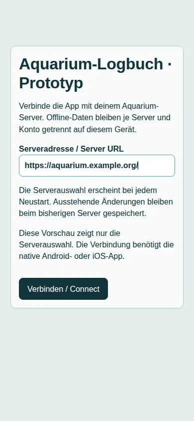
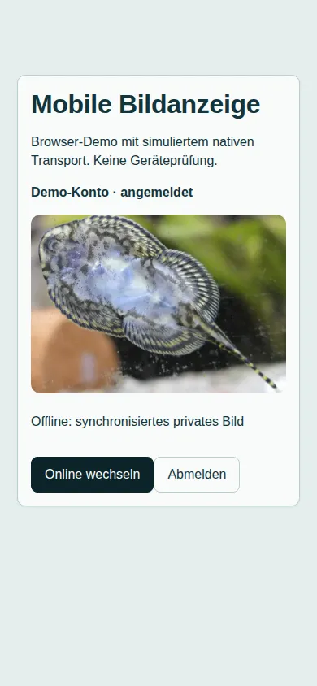

# Capacitor prototype for Android and iOS

[Project overview](../../README.en.md) · [Deutsch](../de/mobile.md)

The prototype reuses the Vue views and browser-safe domain logic. Express and the database remain on the selected aquarium server. This is a development prototype, not a released mobile app.

## Build and launch

Install dependencies with `npm ci`, then run:

```sh
npm run mobile:sync
npm run mobile:android
# On macOS with Xcode:
npm run mobile:ios
```

`build:mobile` checks frontend types and produces `dist/mobile` with its own HTML, icons and browser chunks. The regular web build in `public/dist` is separate. Backend modules, catalog data, the user guide and service worker are excluded. `mobile:sync` builds these files and copies them into the checked-in Android/iOS projects; it does not itself build an APK or IPA. Select a device or emulator in Android Studio or Xcode. See the installed Capacitor 8 requirements for [Android](https://capacitorjs.com/docs/android) and [iOS](https://capacitorjs.com/docs/ios).

iOS builds require macOS and Xcode. TestFlight/App Store distribution additionally requires Apple developer enrollment and signing. The iOS project uses Swift Package Manager. Before publishing, replace the development identifier `de.aquariumlogbuch.prototype`, configure native version/build numbers and replace standard native graphics. Keep signing credentials out of Git.

## Choose a server

Enter an HTTPS address, including an optional installation path, then choose “Connect”. The device must trust the TLS certificate. Embedded credentials, queries and fragments are rejected. The previous address is suggested; connection starts only after selection. The browser preview displays the launcher but disables connection outside a native app.



“Change server” in the footer reloads the local app and returns to selection. Each server including its installation path has a separate IndexedDB, with existing per-user isolation inside it. Pending operations remain with their original server. Changing servers does not log out the previous server session; use logout there first when needed.

## Transport and updates

Capacitor's native HTTP/cookie support forwards API calls to the selected server and retains native cookie handling. Session tokens are not copied into localStorage. Backend CORS and CSRF protections remain unchanged. Local login is the intended test path; device-specific cookie behavior still requires Android/iOS verification.

Native POST responses are buffered, so mobile chat uses the existing JSON reply without pretending buffered progress events arrived live. Web chat keeps its event stream. Client abort discards late results, but a submitted native POST may continue on the server. Existing operation IDs and atomic outbox acknowledgement remain in use.

The native app does not register a service worker or offer web frontend updates. UI updates currently require a new app build; catalogs and user data synchronize separately through the API. Browser updates retain their existing confirmation flow.

## Images and session expiry (second step)

Image requests use the selected server and native cookie handling. Elements display local Blob URLs and release them on unmount or account changes. Late responses are discarded. Relative and absolute server image addresses support installations under a path; local previews stay local.

Synchronized private images remain in per-user IndexedDB records. Valid queued image edits take precedence, and display requests do not overwrite those bytes. Only network failures allow cached-image fallback; HTTP 401/403/404 or a mismatched user identity never reveal an old cached image. A 401 response from `/me` also clears the expired frontend session.

Viewed public species/plant images have a server-specific bounded cache of up to 200 images, each at most 2 MB. Social images remain online. Existing image credits and license details remain in the catalog views.



Demo photo in the screenshot: [5snake5, “Sewellia lineolata – Pracht-Flossensauger”](https://commons.wikimedia.org/wiki/File:Sewellia_lineolata_-_Pracht-Flossensauger.jpg), CC0 1.0; a crop of the existing catalog file.

`test/mobile_session.test.js` exercises local login, API access, image upload/download, chat, expired sessions and logout against a real local backend. Native transport/cookie handling and the external AI provider are simulated. This does not replace Android/iOS TLS and cookie validation or the full offline workflow on a device.

## Remaining validation and features

- Automated checks cover builds, addressing, transport, cancellation, server storage separation, chat and existing offline/catalog behavior. Browser inspection covers launcher rendering only.
- Actual native login and the full online → offline edit → restart → online acknowledgement cycle still need testing on Android and iOS. Linux cannot build or test the native iOS app.
- Mobile OIDC is hidden pending system-browser login and a secure app callback. OIDC-only accounts should use the web app.
- Aquarium, resident, profile, Social and catalog images now use a native image path loaded on demand. Browser checks use a simulated native transport; actual device cookie handling and rendering still need validation.
- Downloads, CSV export, external links, deep links, back navigation, native timer notifications and resume behavior need further implementation or device verification. Background execution is not guaranteed.
- Server compatibility checks, mobile CI, release signing/versioning and store distribution remain open.
